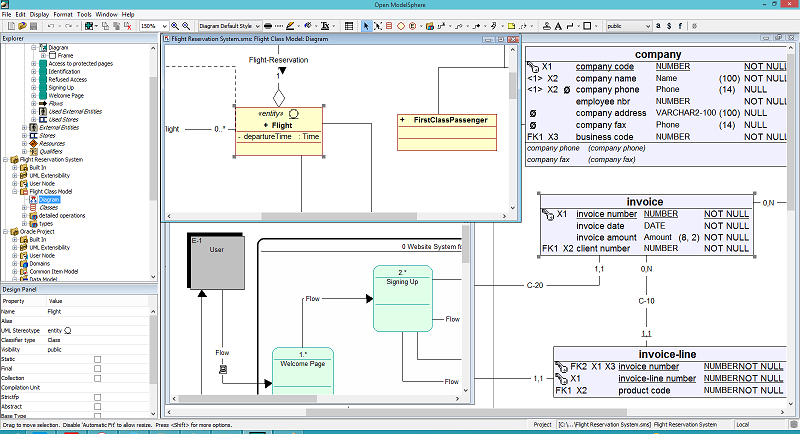

# OpenModelSphere

OpenModelSphere est l'un des outils de modélisation open-source les plus complets pour la conception de systèmes d'information. 
Il couvre la modélisation de données (relationnelle et physique), la modélisation de processus d'affaires et la modélisation UML.




## Caractéristiques Principales
- Modélisation de Données : Support complet des schémas conceptuels, logiques et physiques (ERD).

- Modélisation UML : Diagrammes de classes, de cas d'utilisation, de séquence, etc.

- Modélisation de Processus (BPM) : Pour cartographier les flux de travail de l'entreprise.

- Indépendance DBMS : Génération de code DDL pour les bases de données majeures (Oracle, PostgreSQL, MySQL, SQL Server, etc.).

- Architecture Java : Multiplateforme (Windows, Linux, macOS).

## Changement effectué

Le projet utilise désormait gradle au lieu de ant.
Passage à Java 21 (JDK 21 requis)
Les fichiers java sont passé en UTF 8
la gestion du classhpath a changé entre les version de java, le code a été modifié

## Constatation

Le logiciel démarre sous Linux et est utilisable.
Il y a des erreurs à l'occassion en console, mais je n'ai pas été en mesure de faire rouler la version original afin de pouvoir comparer.


## Compilation

L'application peut être lancé via le module distribution avec la tache run.

## Profilage du demarrage des plugins

Ajouter `-Dmodelsphere.plugins.timing=true` aux options JVM de l'application
(pas aux arguments du programme). Les mesures sont desactivees par defaut.
Avec la tache Gradle `:org.modelsphere.distribution:run`, on peut transmettre
l'option a la JVM enfant via
`JAVA_TOOL_OPTIONS="-Dmodelsphere.plugins.timing=true" ./gradlew :org.modelsphere.distribution:run`.

Les lignes `[plugin-startup]` sont ecrites sur la sortie d'erreur, par exemple :

```text
[plugin-startup] phase=legacy.instance elapsed_ms=12.345 plugin=org.example.MyPlugin
```

Les phases couvrent les configurations, les scans builtin/XML/JAR/classes, le
parsing XML, le chargement des classes, la creation des instances legacy et
l'installation des actions/extensions. `load.total` et `init.total` mesurent
les deux points d'entree du gestionnaire de plugins, pas le demarrage complet
de l'application. Les durees utilisent une horloge monotone et incluent les
sous-phases : ne pas additionner toutes les lignes. Une ligne indique le temps
ecoule, meme en cas d'echec, et non le succes de l'operation. La sortie de
diagnostic ajoute elle-meme un cout aux phases parentes.

Comparer plusieurs lancements a froid et a chaud avec les memes plugins et
preferences. Pour analyser CPU, allocations, chargements de classes et E/S,
ajouter egalement aux options JVM :
`-XX:StartFlightRecording=filename=plugin-startup.jfr,settings=profile,dumponexit=true`.
Fermer normalement l'application pour sauvegarder l'enregistrement, puis
l'ouvrir avec Java Mission Control. Ne pas versionner les captures ni les logs.

La decouverte legacy lit le manifeste une fois par JAR et par passage de scanner,
puis reutilise ces metadonnees pour les candidats du meme JAR. Les contextes des
plugins restent distincts et les handles de decouverte sont fermes immediatement ;
les class loaders restent disponibles pour charger les plugins ensuite.
Les scanners JAR et classes restent separes et l'ordre d'initialisation est inchange.
Verification ciblee : `./gradlew :org.modelsphere.jack:testPluginJarDiscovery`.

Les deux lecteurs de plugins XML utilisent le meme decodage des bundles :
UTF-8 avec compatibilite ISO-8859-1 pour les anciens fichiers `.properties`
(comportement Java 17 par defaut). Le registre remplace les anciennes signatures
par leur classe de plugin, jamais par leur nom traduit, pour eviter les doublons
dans la liste. Verification : `./gradlew :org.modelsphere.jack:testPluginXmlDiscovery`.
